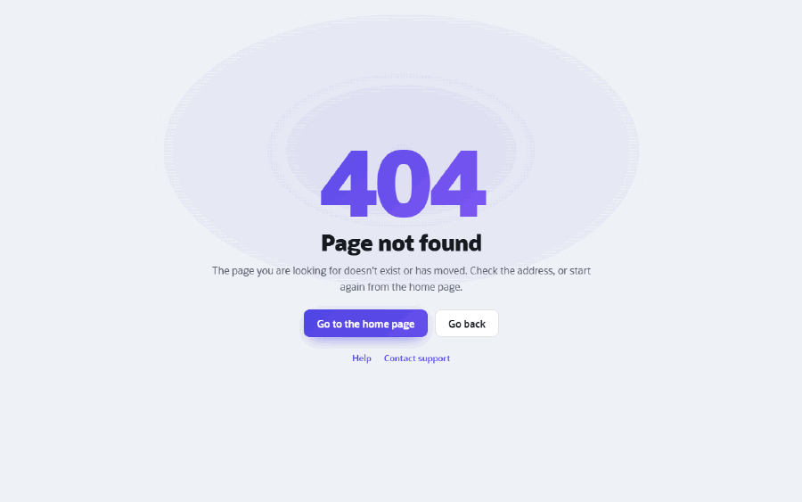
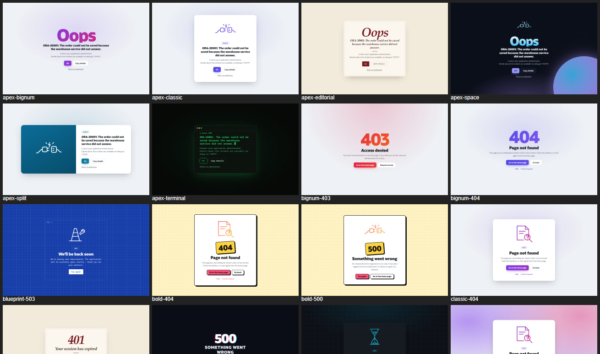
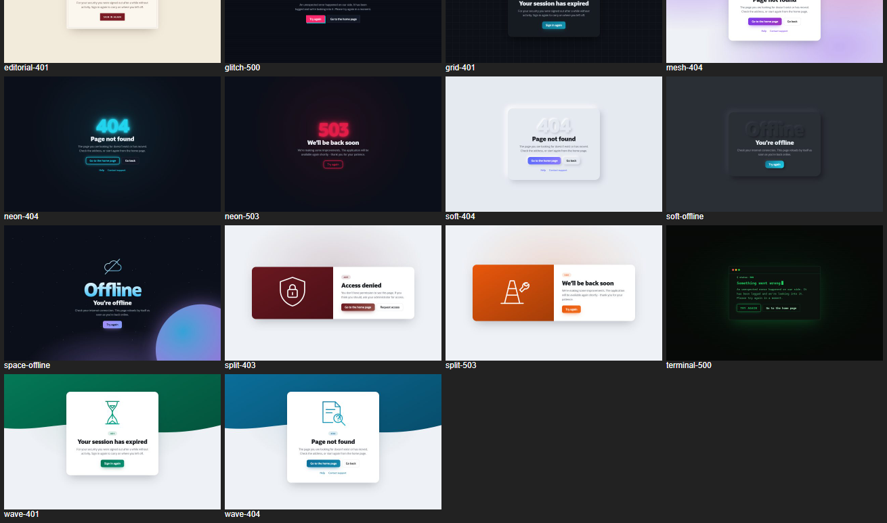
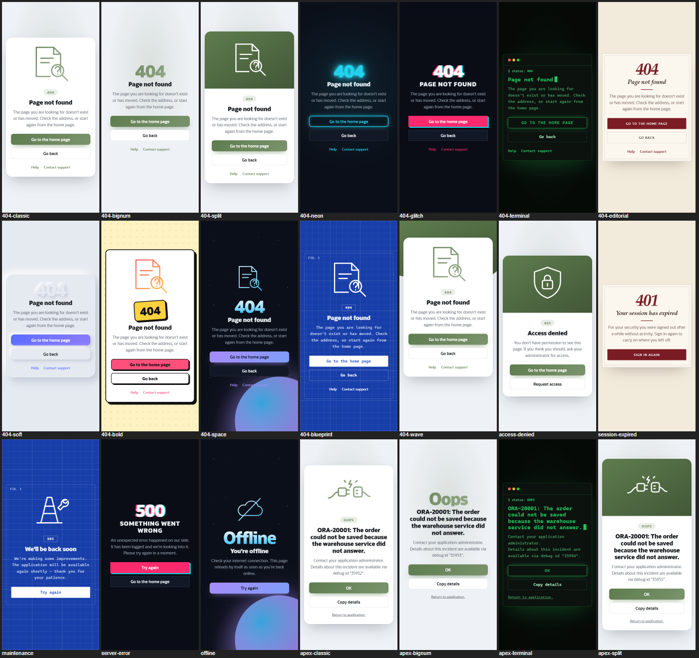
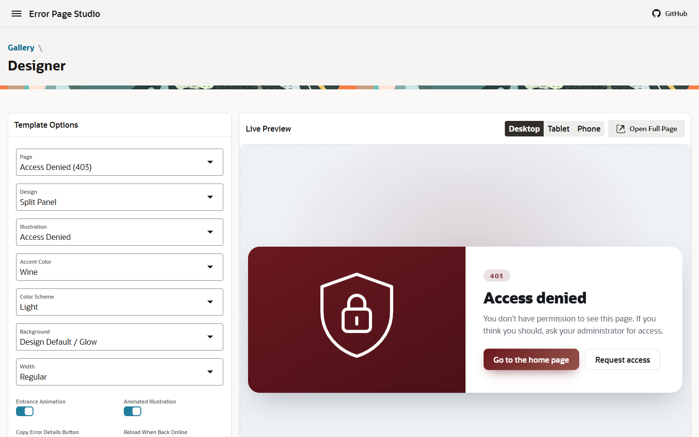

# Error Page Studio for Oracle APEX

[](https://apex.oracle.com) [](LICENSE)

Friendly, good-looking error pages for Oracle APEX - **one page template for APEX's own error page and for your 404, access denied, session expired, maintenance, server error and offline pages**. 12 designs, line illustrations, light and dark. Every look is a template option: nothing to code.



Error Page Studio is a small APEX application: a **Gallery** of ready-made looks, a **Designer** that previews every option live on phone, tablet and desktop and hands you the options and the page text, demo pages for every error, and the **Modern Error** page template itself, which you copy into your own application.

## Designs

| Design | Look |
|---|---|
| Classic | A card with a line illustration |
| Big Number | No card - a huge gradient code (404, 503, Oops) |
| Split Panel | The illustration on a coloured panel next to the message |
| Neon | Dark, a glowing, flickering code |
| Glitch | Dark, a jittering colour-split code |
| Terminal | A console window with a blinking cursor |
| Editorial | Paper colours, serif type, fine rules |
| Soft UI | Neumorphic - an embossed code on a raised card |
| Bold | Neo-brutalist - ink outlines, hard shadows, a sticker code |
| Space | Stars, a planet and a floating illustration |
| Blueprint | A technical drawing on blue grid paper |
| Wave | A coloured band with a wave edge behind the card |

Plus six **illustrations** (not found, access denied, session expired, maintenance, server error, offline) drawn in the accent colours, 10 **accent colours**, **light / dark / follow the device**, **backgrounds** (glow, mesh, bold gradient, dots, grid lines, rings, solid, your own image), and:

- **Copy error details** - on APEX's error page, one click copies the message, details, page address and time for a support ticket;
- **Reload when back online** - the offline page comes back by itself;
- **Back** and **Try again** buttons that just work (`me-Back`, `me-Reload`);
- entrance animation and a floating illustration (off for users who prefer reduced motion).




<details><summary>On a phone</summary>


</details>

## Install

1. Download [`error-page-studio.sql`](error-page-studio.sql).
2. **App Builder > Import**, install it with any application ID. No database objects; **APEX 26.1** or later.
3. Run it - every page is public. *Try a Real Error* raises an error so you can see APEX's error page in the template.

The APEXlang source is in [`apexlang/`](apexlang/); the template is built from [`apexlang/_src`](apexlang/_src) (`node _src/build.mjs`).

## Use it in your application

**Copy the template:** in *your* application open **Shared Components > Templates > Create > Page > As a Copy of an Existing Template**, copy from **Error Page Studio** and pick **Modern Error** (tick *Subscribe* for later updates).

**APEX's own error page** (unhandled errors in processes, authorization failures, broken queries):

1. **Shared Components > Themes >** your theme **> Component Defaults > Error Page** = **Modern Error**.
2. **Shared Components > Templates > Modern Error > Default Template Options**: pick the look - in the Designer choose *Page = APEX Error Page*. APEX always uses these defaults on its error page, whatever page failed.

**Your own error pages:** create a public page with Page Template **Modern Error**, pick its Template Options, and put the message in a Static Content region (template *Blank with Attributes*) in the **Content Body** slot - the Designer gives you both:

```html
<p class="me-Code">404</p>
<h1 class="me-Title">Page not found</h1>
<p class="me-Text">The page you are looking for doesn't exist or has moved.</p>
<div class="me-Actions">
  <a class="me-Btn me-Btn--primary" href="f?p=&APP_ID.:1:&APP_SESSION.">Go to the home page</a>
  <button type="button" class="me-Btn me-Back">Go back</button>
</div>
```

Then point APEX at them:

| Page | How users get there |
|---|---|
| Session Expired | Security Attributes > Session Management: **Session Timeout URL** and **Session Idle Timeout URL** = the page (it must be public) |
| Not Found | Redirect to it when a record does not exist. A page number that does not exist shows APEX's built-in "Sorry, this page isn't available" screen, which templates cannot change. |
| Access Denied | Authorization failures appear on APEX's error page; redirect to a dedicated page from your own checks |
| Maintenance | Availability: **Unavailable (Redirect to URL)** pointing to the page in another application (an unavailable application cannot show its own pages) |
| Server Error / Offline | Link or redirect to them from your own error handling |

The How to Use page of the app also has a sample **error handling function** that turns ORA messages into friendly ones.

Helper classes: `me-Code`, `me-Title`, `me-Text`, `me-Actions`, `me-Btn`, `me-Btn--primary`, `me-Back` (go back), `me-Reload` (try again), `me-Links` (a list of links). Optional slots: Top Bar, Page Footer, Background Image. The Copy button's text can be translated with the text message `MODERN_ERROR.COPY`.



## Notes

- The template is self-contained - CSS, JavaScript and illustrations travel with it.
- APEX fills these into the error page: `#MESSAGE#`, `#ADDITIONAL_INFO#`, `#TECHNICAL_INFO#`, `#OK#`, `#RETURN_TO_APPLICATION#`, `#BACK_LINK#` and `&HOME_LINK.`.

## Support

Questions, bugs and ideas: [GitHub Issues](https://github.com/HashaamShoukat/apex-error-page-studio/issues).

[MIT](LICENSE) © 2026 Hashaam Shoukat
